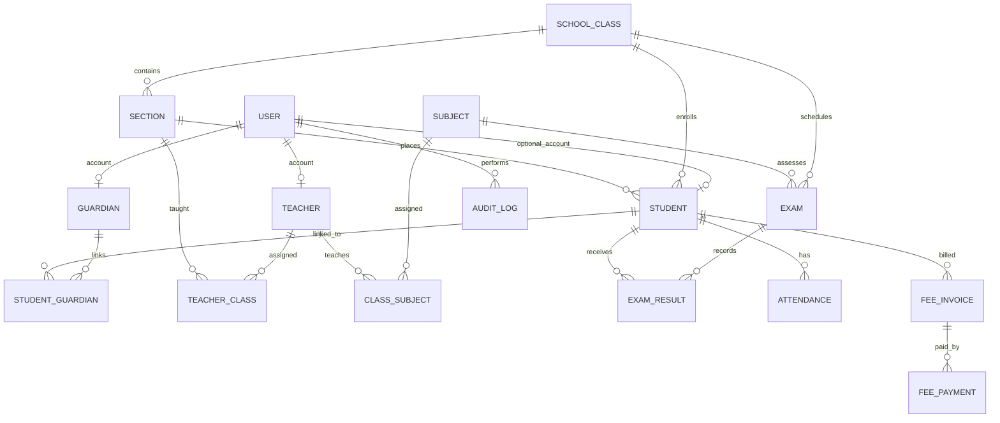

# BrightPath School — School Management System

A responsive, database-backed school operations MVP for administrators, teachers, guardians and students. The app uses synthetic demo records only and runs locally with SQLite.

## What works

- **Authentication and server-side RBAC:** Public signup for all four roles, JWT login, active-account checks, teacher section scoping and guardian-to-student privacy boundaries. Local demo signup is immediate; production administrator access requires approval.
- **Academic administration:** students, teachers, guardians, classes, sections, subjects, teacher assignments and class/subject assignments.
- **Attendance:** daily AM/PM attendance, class/student/date filters, summaries, teacher section authorization and a unique student/date/session constraint.
- **Examinations:** class/section exams, configurable percentage grading rules, mark validation, safely repeatable result entry and student report cards.
- **Fees:** invoices and a simulated-payment ledger stored in integer paise. Conditional database updates, idempotency keys and transactions protect balances from duplicate/oversized payments.
- **Reports and audit:** role-scoped attendance totals, fee reconciliation and an administrator-only audit trail of material actions.
- **Usability:** responsive layout, search and pagination for the student directory, accessible form labels, loading/empty/error/success states and role-specific navigation.

## Architecture

- `frontend/`: React 19 + Vite single-page application.
- `backend/`: Express API with route modules, authentication middleware and business-rule helpers.
- `backend/prisma/`: SQLite Prisma schema, migrations and repeatable synthetic seed script. The earlier PostgreSQL baseline is preserved in `backend/prisma/migrations-postgresql-baseline`.
- SQLite is the local persistence layer; Prisma provides migrations, relations, unique constraints and indexes.

Schema overview:



See [API documentation](./docs/openapi.yaml), served locally at `http://localhost:5000/api-docs`, [technical report](./docs/technical-report.md) and [walkthrough outline](./docs/demo-walkthrough.md).

## Local setup (Windows PowerShell)

Use two terminals from the project directory.

### 1. Backend and database

```powershell
cd backend
Copy-Item .env.example .env
npm install
npm run db:setup
npm run dev
```

SQLite requires no separate database service. `DATABASE_URL` in `.env.example` uses the existing local database file at `backend/prisma/dev.db`; set a long, random local `JWT_SECRET` in `backend/.env`. `npm run db:setup` applies the committed SQLite migrations and inserts synthetic demo accounts and sample records. The PostgreSQL baseline from the attempted migration is preserved separately and is not used by local setup. Do not commit `.env` or any local database.

### 2. Frontend

```powershell
cd frontend
Copy-Item .env.example .env
npm install
npm run dev
```

Open the Vite URL (normally `http://localhost:5173`). `VITE_API_URL` may be changed in `frontend/.env` if the API runs elsewhere. The API defaults to `http://localhost:5000`; `CORS_ORIGIN` can be set in `backend/.env`.

### Demo accounts

Visitors can choose **Create account** and register as a guardian, student, teacher or administrator. In local development, all four account types can sign in immediately. Guardian/student accounts need a link to the correct student record before private records are visible, and teachers need class assignments before school data is available. In production (`NODE_ENV=production`), administrator registrations require approval from an existing administrator in **Teaching team → Account requests** to protect school-wide access.

All accounts are seeded with the same dummy password: `Demo123!`

| Role | Email |
|---|---|
| Administrator | `admin@demo.school` |
| Teacher | `teacher@demo.school` |
| Guardian | `guardian@demo.school` |
| Student | `student@demo.school` |

These are local evaluation accounts, not production credentials. The teacher is assigned to Grade 8 / A and Grade 7 / B; the guardian is linked only to Sam Rivera; the student account is Sam's own account.

The repeatable seed also provides fictional class rosters, a seven-day attendance history, past assessments and a fee invoice for every seeded student, upcoming exams and a partially paid invoice so dashboard charts and financial totals have data to display. Student admission numbers use a school-style `BPS-YYYY-NNNN` format, staff numbers use `TCH-YYYY-NNN`, and invoices use `BPS-INV-YYYY-NNNN`. All names and records are synthetic; demo login emails stay clearly marked with `@demo.school`.

## API, migrations and tests

- API prefix: `/api`. Protected endpoints require `Authorization: Bearer <token>`.
- Simulated fee payments require an `Idempotency-Key` header and an integer `amountCents` body field.
- Interactive API documentation is served at `http://localhost:5000/api-docs`.
- Database migration: `cd backend; npx prisma migrate deploy`
- Add/update a local migration after schema changes: `cd backend; npm run db:migrate -- --name <migration_name>`
- Regenerate the Prisma client after schema changes: `cd backend; npx prisma generate`
- Seed demo data: `cd backend; npm run db:seed`
- Test Jest/Supertest API and business rules plus seeded end-to-end flows: `cd backend; npm test`
- Frontend checks: `cd frontend; npm run lint; npm run build`

`npm test` re-seeds the local demo data before running the API integration checks. Tests verify unauthenticated denial, teacher section scope, duplicate attendance conflict, guardian privacy, grade calculations, idempotent payment and overpayment rejection.

## Limitations and submission notes

- This is a local-only demo; no live deployment or hosted URL has been provisioned.
- Payments are simulated ledger entries only. No payment processor or real financial credentials are used.
- Password reset, account invitation/activation, session revocation, bulk attendance import, configurable school branding and production operational monitoring are not included.
- Grade thresholds can be configured per exam through the API. The current UI uses the default A–F grading bands.
- Guardian/student accounts need an administrator to link them to the correct school record; teachers need an administrator to assign classes. Local account registration is open for all roles to support the assessment demo.
- The repository does not include candidate identity details, a private repository URL, final commit ID, reviewer access or a recorded video. Those submission-form fields and a 3–5 minute recording must be completed by the candidate. A suggested walkthrough is in `docs/demo-walkthrough.md`.
- The sample records use fictional names and numbers. No real student, guardian or payment data should be added to a public submission.

## Attribution and AI assistance

Implementation assistance: OpenAI Copilot SDK in VS Code. Application data is synthetic and generated by the local Prisma seed. Runtime libraries and their licenses are declared in `backend/package.json` and `frontend/package.json`.
